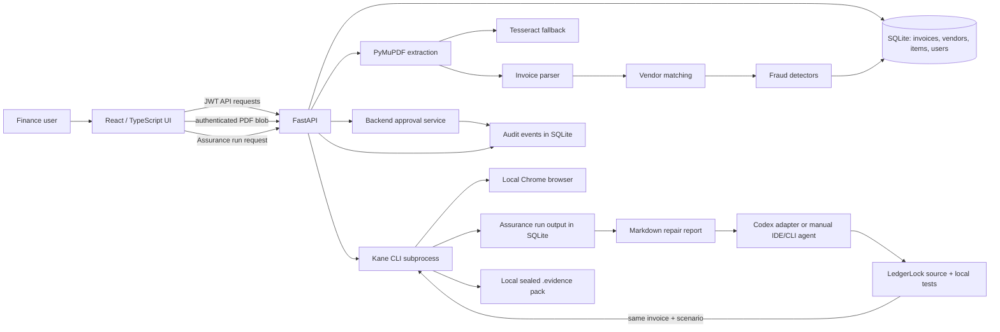
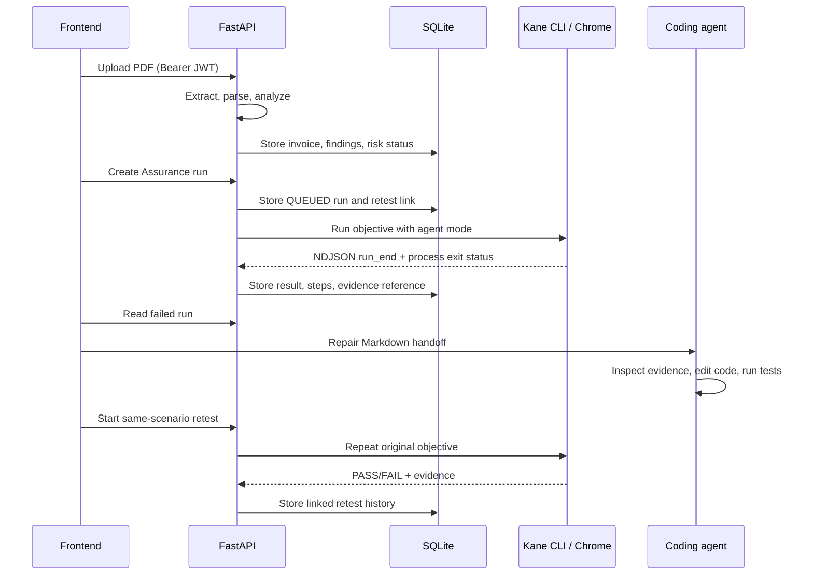

# LedgerLock

> **Every invoice deserves verification before payment.**

LedgerLock is an invoice-intelligence and accounts-payable security application for small and medium-sized businesses. It extracts invoice data from PDFs, compares invoices with vendor history, records explainable risk findings, enforces reviewer/approver separation in the API, and retains an audit trail. The Kane Assurance Lab submits real browser objectives to Kane CLI and stores the result, execution steps, and evidence reference. A failed result can be handed to a coding agent, then retested against the same invoice and scenario.

**Hackathon:** KaneCLI Online Hackathon by TestMu AI, November 2026. **Status:** local implementation, automated tests, and an isolated real-browser approval-guard Kane PASS were verified. Public-history cleanup remains a release prerequisite (see [Known release blockers](#known-release-blockers)).

**Stack:** Python 3.13, FastAPI, SQLAlchemy, SQLite, PyMuPDF, Tesseract OCR, RapidFuzz, React 19, TypeScript, Vite, Tailwind CSS, Kane CLI.

**Repository:** [github.com/Biki-dev/ledgerlock](https://github.com/Biki-dev/ledgerlock) (configured Git remote; confirm visibility and access before sharing). No hosted deployment URL is configured.

## Contents

- [LedgerLock](#ledgerlock)
  - [Contents](#contents)
  - [Judge's 10-15 Minute Evaluation Guide](#judges-10-15-minute-evaluation-guide)
  - [Problem and Solution](#problem-and-solution)
  - [Architecture and Data Flow](#architecture-and-data-flow)
  - [Features and Repository Layout](#features-and-repository-layout)
  - [Prerequisites and Installation](#prerequisites-and-installation)
    - [Fresh installation](#fresh-installation)
  - [Environment Variables and Demo Users](#environment-variables-and-demo-users)
  - [Run the Application](#run-the-application)
  - [Judge Walkthrough](#judge-walkthrough)
  - [Fraud Rules and Limits](#fraud-rules-and-limits)
  - [Authentication and Approval Security](#authentication-and-approval-security)
  - [Testing](#testing)
  - [Kane CLI Integration](#kane-cli-integration)
  - [Coding-Agent Handoff](#coding-agent-handoff)
  - [Closed-Loop Demonstration](#closed-loop-demonstration)
  - [Run History and Evidence](#run-history-and-evidence)
  - [API Reference](#api-reference)
    - [Authentication](#authentication)
    - [Invoices and risk](#invoices-and-risk)
    - [Review, approval, and audit](#review-approval-and-audit)
    - [Kane Assurance](#kane-assurance)
  - [Where to Find Each Implementation](#where-to-find-each-implementation)
  - [How LedgerLock Satisfies the Hackathon Criteria](#how-ledgerlock-satisfies-the-hackathon-criteria)
    - [Criterion 1: SHIPS (25%)](#criterion-1-ships-25)
    - [Criterion 2: VERIFIED (25%)](#criterion-2-verified-25)
    - [Criterion 3: CLOSED LOOP (25%)](#criterion-3-closed-loop-25)
    - [Criterion 4: CRAFT (25%)](#criterion-4-craft-25)
  - [Troubleshooting](#troubleshooting)
  - [Security and Limitations](#security-and-limitations)
  - [Repository and License Readiness](#repository-and-license-readiness)
  - [Known Release Blockers](#known-release-blockers)

Supporting references: [Architecture](docs/ARCHITECTURE.md) · [Judge Guide](docs/JUDGE_GUIDE.md) · [Kane Integration](docs/KANE_INTEGRATION.md) · [Agent Handoff](docs/AGENT_INTEGRATION.md).

## Judge's 10-15 Minute Evaluation Guide

Before the demo, install the app and dependencies (typically 5-10 minutes on a prepared machine). Kane registration/authentication, account credits, and coding-agent setup are separate prerequisites and can take longer. The full agent-repair demonstration is not a 10-minute setup task.

1. Clone the repository and follow [fresh installation](#fresh-installation).
2. Generate a local `.env`, seed synthetic vendors/history and three role accounts, then start backend and frontend.
3. Sign in as `reviewer@ledgerlock.demo` using the locally configured reviewer password.
4. Generate PDFs and upload `normal.pdf`; inspect extracted values, line items, risk findings, and PDF preview.
5. Upload `bank_changed.pdf` and inspect the bank-change HOLD finding. Upload `price_inflated.pdf` to inspect the historical-price REVIEW finding.
6. Upload the same `normal.pdf` bytes a second time to see the exact-file duplicate HOLD.
7. Complete the bank verification as reviewer, sign in separately as the approver, try the approval action, and inspect the audit history.
8. Sign in to Kane CLI, open `/assurance`, select the pending scenario-compatible invoice, and run a scenario. Inspect its run record and evidence.
9. On a failed run, generate a repair prompt with `backend/.venv/bin/python scripts/repair_from_kane.py RUN_ID --manual` and hand it to the coding agent.
10. Run tests, then choose **Run same scenario again**. A Kane PASS on the linked retest, not the agent's process status, is the evidence that the repair worked.

## Problem and Solution

SME accounts-payable teams can receive duplicate invoices, invoices with substituted vendor payment details, unusual price changes, arithmetic errors, or incomplete documents. Manual review can be inconsistent, and decisions may lack a durable record.

LedgerLock follows this workflow:

```text
PDF upload -> text extraction or OCR -> invoice parsing -> vendor match
           -> duplicate/bank/price/arithmetic checks -> risk findings
           -> reviewer/verification/approver policy -> append-only audit events
```

- **CLEAR:** no configured detector or completeness check generated a finding. This is not a guarantee that an invoice is genuine.
- **REVIEW:** one or more review findings exist, but there is no HOLD action. A reviewer must clear a REVIEW invoice before a different approver can approve it.
- **HOLD:** at least one detector emitted a blocking finding. The supported exception is a sole `BANK_DETAILS_CHANGED` finding after independent human verification and approval by a different user. Duplicate HOLDs and mixed HOLD findings cannot use that exception.

## Architecture and Data Flow





## Features and Repository Layout

| Area | Implemented behavior | Primary source |
|---|---|---|
| Ingestion | PDF extension/signature checks, 10 MB limit, extraction, vendor resolution, line items, SHA256, transactional persistence | `backend/routes/invoices.py`, `backend/services/pdf_extractor.py`, `backend/services/invoice_parser.py` |
| OCR | Tesseract fallback when digital PDF text is short; maximum 25 PDF pages and OCR on at most 10 pages | `backend/services/pdf_extractor.py` |
| Fraud | Exact/number/near duplicates, bank changes, price history, arithmetic, missing/incomplete data, explainable findings | `backend/services/duplicate_detector.py`, `bank_detector.py`, `price_detector.py`, `arithmetic_detector.py`, `fraud_engine.py` |
| Approval | JWT roles, reviewer clearance, independent bank verification, two-person rule, rejection, backend policy checks | `backend/core/`, `backend/routes/approvals.py`, `backend/services/approval_service.py` |
| Audit | Per-invoice and global read-only history APIs | `backend/models/audit_event.py`, `backend/services/audit_service.py`, `backend/routes/audit.py` |
| Assurance | Four browser scenarios, run lifecycle/output, linked retest and evidence lookup | `backend/routes/assurance.py`, `backend/services/kane_runner.py`, `kane_execution.py`, `kane_parser.py` |
| Agent handoff | Failure report generation; optional Codex `exec` adapter; manual Markdown handoff for other agents | `scripts/repair_from_kane.py` |
| Frontend | Dashboard, queue/search/filters/upload, invoice details, PDF preview, approval actions, audit, Assurance Lab | `frontend/src/pages/`, `frontend/src/components/` |

Top-level layout (generated caches, SQLite data, uploads, `node_modules`, and virtual environments omitted):

```text
.
├── AGENTS.md
├── README.md
├── .env.example
├── docs/
├── scripts/repair_from_kane.py
├── backend/
│   ├── core/                 # JWT, role dependencies, demo-secret checks
│   ├── models/               # SQLAlchemy entities
│   ├── routes/               # auth, invoice, approval, audit, assurance APIs
│   ├── schemas/              # Pydantic request/response models
│   ├── services/             # extraction, fraud, approval, Kane services
│   ├── tests/                # pytest unit/handler/migration tests
│   ├── scripts/              # synthetic invoice reset utility
│   ├── migrate_phase2.py
│   ├── migrate_phase3.py
│   ├── migrate_phase5.py
│   ├── seed_demo.py
│   └── seed_users.py
└── frontend/
    ├── src/context/          # authentication state
    ├── src/pages/            # dashboard, queue, details, audit, Assurance
    ├── src/services/api.ts   # Axios base URL and JWT interceptor
    └── package.json
```

No screenshot files are committed as product screenshots, so this README does not present mockups as running features.

## Prerequisites and Installation

Verified development environment: Fedora Linux 44, Python 3.13.13 in `backend/.venv`, Node.js 20.20.2, npm 10.8.2, Google Chrome, Tesseract, and Kane CLI 0.10.5. Use Python 3.13 for the reproducible setup described here. Linux is the exercised environment; macOS/Windows have not been integration-tested (Windows users should use WSL2).

System prerequisites:

- Python 3.13 and `venv`/`pip`.
- Node.js 20 LTS and npm.
- Tesseract OCR (`tesseract` executable) for scanned PDFs. On Fedora install from the configured Fedora package source, for example `sudo dnf install tesseract`.
- Google Chrome or Chromium for local real-browser Kane execution. Chrome is installed at `/usr/bin/google-chrome` in the inspected environment.
- Kane CLI and a TestMu AI account with authentication and credits for external browser execution. The CLI itself is not a Python/npm project dependency.

### Fresh installation

```bash
git clone https://github.com/Biki-dev/ledgerlock.git
cd ledgerlock

python3.13 -m venv backend/.venv
source backend/.venv/bin/activate
python -m pip install --upgrade pip
python -m pip install -r backend/requirements-lock.txt

cp .env.example backend/.env
# Edit backend/.env: use a random JWT key and three unique passwords.

cd frontend
npm ci
cd ..

cd backend
python migrate_phase2.py
python migrate_phase3.py
python migrate_phase5.py
python seed_demo.py
python seed_users.py
```

Generate values locally; do not paste them into Git or chat:

```bash
openssl rand -hex 32
openssl rand -hex 24
openssl rand -hex 24
openssl rand -hex 24
```

Use the first value for `JWT_SECRET_KEY` and the next three for the reviewer, approver, and admin passwords. They must be distinct; each demo password must be at least 16 characters. `seed_users.py` updates the local demo hashes to the configured values. Startup intentionally refuses to serve if an existing demo account does not match its configured secret.

The SQLite database is `backend/ledgerlock.db`, created locally and ignored by Git. Startup migrations are also invoked by `backend/main.py`; the explicit migration commands above make fresh-clone setup visible and repeatable. `seed_demo.py` creates three synthetic vendors with three historical invoices each. `tests/create_test_invoices.py` generates additional synthetic PDFs under `backend/tests/generated/`.

## Environment Variables and Demo Users

Copy [`.env.example`](.env.example) to `backend/.env`; never commit the resulting `.env`.

| Variable | Purpose | Required |
|---|---|---|
| `JWT_SECRET_KEY` | JWT signing secret; startup requires at least 32 characters | Yes |
| `JWT_ALGORITHM` | JWT algorithm; defaults/documented as `HS256` | No |
| `JWT_EXPIRE_MINUTES` | Token lifetime in minutes; defaults to 60 | No |
| `LEDGERLOCK_DATABASE_URL` | SQLite URL; defaults to the repository-local `backend/ledgerlock.db` | No |

`backend/requirements.txt` lists pinned direct runtime dependencies; `backend/requirements-dev.txt` adds test-only dependencies; `backend/requirements-lock.txt` pins the full Python 3.13 environment used for validation on Fedora. Revalidate/refresh the lock deliberately when changing Python or operating systems.
| `DEMO_REVIEWER_PASSWORD` | Local seeded finance-reviewer password | Yes for seeded reviewer |
| `DEMO_APPROVER_PASSWORD` | Local seeded finance-approver password and Kane variable | Yes for approver/Kane |
| `DEMO_ADMIN_PASSWORD` | Local seeded admin password | Yes for seeded admin |
| `KANE_BASE_URL` | Frontend URL opened by the Kane scenarios; defaults to `http://localhost:5173` | Yes for Kane runs |
| `KANE_APPROVER_EMAIL` | Kane login email; defaults to the demo approver address | No |
| `FRONTEND_ORIGINS` | Comma-separated CORS origins; defaults to localhost and 127.0.0.1 on port 5173 | No |
| `VITE_API_URL` | Frontend Axios base URL; defaults to `http://localhost:8000` | No for local setup |

The frontend API URL is a Vite environment variable; create `frontend/.env.local` for a non-default API URL. The backend CORS allowlist defaults to `http://localhost:5173` and `http://127.0.0.1:5173`; configure `FRONTEND_ORIGINS` for another deployment origin. TestMu credentials are configured by `kane-cli login`, not stored in `.env`. Agent credentials belong to the chosen agent CLI/IDE and are not read by LedgerLock.

`seed_users.py` creates these local accounts, with passwords supplied only by the local environment:

| Account | Role | Permissions demonstrated |
|---|---|---|
| `reviewer@ledgerlock.demo` | `FINANCE_REVIEWER` | Upload, review, verify bank changes, inspect invoices/audit |
| `approver@ledgerlock.demo` | `FINANCE_APPROVER` | Approve/reject where allowed, inspect invoices/audit |
| `admin@ledgerlock.demo` | `ADMIN` | Administrative role, review/verification and approval endpoints |

There are no default passwords in the repository. Read the local generated values from `backend/.env` when signing in.

## Run the Application

Terminal 1, backend (keep this terminal open):

```bash
cd backend
source .venv/bin/activate
uvicorn main:app --reload --host 127.0.0.1 --port 8000
```

Terminal 2, frontend (keep this terminal open):

```bash
cd frontend
npm run dev -- --host 127.0.0.1
```

- Frontend: <http://127.0.0.1:5173/>
- API health: <http://127.0.0.1:8000/health>
- Swagger: <http://127.0.0.1:8000/docs>
- Kane Assurance Lab: <http://127.0.0.1:5173/assurance>

The frontend requests authenticated blobs from `/api/invoices/{id}/source`; opening a stored PDF URL directly without a Bearer token is expected to return 401.

## Judge Walkthrough

1. Log in as a reviewer using `reviewer@ledgerlock.demo` and the local environment password.
2. Generate PDFs from the backend directory:

   ```bash
   cd backend
   python tests/create_test_invoices.py
   ```

3. Upload `tests/generated/normal.pdf` from the invoice queue. The seeded vendor matches by normalized vendor name because the test invoice uses a deliberately synthetic GSTIN. Its line total/subtotal/tax arithmetic is internally consistent, so it should be CLEAR when the seeded data is present and the file has not already been uploaded.
4. Open invoice details. Inspect extracted fields, line items, risk score/findings, and the authenticated PDF preview.
5. Upload `tests/generated/bank_changed.pdf`. It uses the seeded vendor GSTIN but a different account; expect a bank-change HOLD. As reviewer, submit a method, reference, and note in the bank verification form.
6. Log out and sign in as `approver@ledgerlock.demo`. The approver is a different user. Approve the verified bank-change invoice; the risk status remains HOLD as a historical risk classification, while approval status becomes APPROVED.
7. Open per-invoice and global audit history. The review/verification/approval actors and timestamps should be visible.
8. Upload `tests/generated/price_inflated.pdf`; seeded Steel Rod history is $100, $101, and $102 per unit, while the generated invoice uses $140. The detector requires at least three matching historical line items and flags an increase at or above 30% for REVIEW.
9. Upload `normal.pdf` a second time without changing its bytes. The SHA256 detector should issue `EXACT_FILE_DUPLICATE` and HOLD the second invoice.
10. Open Assurance Lab, choose an invoice whose status and findings match one of the scenarios, and run Kane. A successful account login and available Kane credits are required.

The generated `duplicate_test.pdf` is a distinct invoice number, not a duplicate by itself. For exact-file duplicate behavior, upload identical bytes twice. `sample_invoice.pdf` is a parser sample, not the seeded normal-approval fixture.

## Fraud Rules and Limits

| Detector | Implemented rule |
|---|---|
| Exact PDF | Equal SHA256 to a previous invoice produces `EXACT_FILE_DUPLICATE` / HOLD. |
| Invoice number | Same matched vendor and normalized invoice number produces `DUPLICATE_INVOICE_NUMBER` / HOLD. |
| Near duplicate | Same vendor, normalized invoice-number similarity at least 92%, totals within `max($1, 1%)`, and dates within 60 days (or a missing date) produces `POSSIBLE_DUPLICATE` / REVIEW. |
| Bank account and IFSC | A difference from a verified vendor profile produces `BANK_DETAILS_CHANGED` / HOLD. Missing bank values produce review findings. New invoice data never overwrites the trusted vendor bank profile. |
| Price anomaly | Compare same-vendor line descriptions with RapidFuzz token-set similarity at least 85. At least three historical matching line items are required; a current unit price at least 30% above their median produces REVIEW. |
| Line arithmetic | Quantity × unit price may differ from line total by at most $0.05. |
| Subtotal | Sum of item line totals may differ from invoice subtotal by at most $1.00. |
| Grand total | Subtotal + tax may differ from invoice total by at most $1.00. |
| Completeness | Incomplete extraction or missing vendor/invoice number/total creates review findings. |

Risk score is a heuristic: severity weights are CRITICAL=100, HIGH=75, MEDIUM=35, LOW=10, summed and capped at 100. Any HOLD action makes the invoice HOLD; otherwise any finding makes it REVIEW; no findings makes it CLEAR. The score is not a calibrated probability of fraud. Vendor-name normalization, PDF extraction, and fuzzy line matching can make mistakes. Insufficient price history is not treated as an anomaly. Human review is required; LedgerLock does not determine criminal intent.

## Authentication and Approval Security

Login is `POST /api/auth/login`. A password is verified against a `pwdlib` hash; the API issues a signed JWT. `get_current_user` validates the Bearer token and active user, while `require_roles` applies role checks. The Axios interceptor attaches the token and clears saved state on 401. Frontend route protection improves navigation but is not the security boundary.

Invoice upload/list/detail/PDF/risk endpoints and audit endpoints require JWT roles. Manual analysis is restricted to reviewer/admin. Approval rules are enforced in `services/approval_service.py` and the approval endpoints:

- Reviewer clearance is required for REVIEW invoices; the reviewer cannot be the approver.
- Bank-change verification requires the sole HOLD finding to be `BANK_DETAILS_CHANGED`; the verifier cannot approve.
- Duplicate or mixed HOLDs cannot be released by the bank exception.
- Rejected/finalized invoices cannot be approved or reanalyzed.
- A blocked approval attempt is recorded as a BLOCKED audit event.
- Audit APIs are read-only; there is no audit update/delete route.

The approver action remains clickable for an authorized approver even if requirements are unmet. The backend responds with a conflict and records the blocked attempt. This lets Kane verify actual server enforcement rather than a disabled frontend button.

## Testing

Backend, from the `backend` directory:

```bash
source .venv/bin/activate
pytest -v
pytest -v tests/test_invoice_parser.py
pytest -v tests/test_phase2.py
pytest -v tests/test_approval_service.py tests/test_phase3_routes.py
pytest -v tests/test_kane_parser.py tests/test_kane_execution.py
```

Frontend, from the `frontend` directory:

```bash
npm ci
npm run lint
npm run build
```

The Python tests cover parser output, fraud detectors, policy service, HTTP-level authentication/role checks and protected PDF access, migration behavior, audit persistence/readback, Kane NDJSON parsing, evidence path lookup, secret-file handling, retest linkage, agent feedback, and synthetic-invoice reset safety. Some workflow tests call route handlers directly; `tests/test_api_security.py` uses FastAPI `TestClient` with the pinned `httpx2` development dependency and an isolated in-memory SQLite database. There is no frontend unit-test script; TypeScript/Vite build and ESLint are the available frontend checks.

## Kane CLI Integration

Kane CLI is TestMu AI's natural-language browser automation and assurance CLI. LedgerLock uses `kane-cli run --agent` against the local Vite application and stores parsed NDJSON events and the final outcome. In the inspected environment, Kane CLI is `@testmuai/kane-cli` version `0.10.5`; `kane-cli run --help` confirms `--agent`, `--max-steps`, `--timeout`, `--url`, and `--variables-file`. Its help describes Agent mode as plain NDJSON output. The runner only marks PASSED when process exit code is zero and `run_end.status` is `passed`; a missing `run_end` is ERROR, not PASS.

Official resources:

- [Kane CLI introduction](https://www.testmuai.com/support/docs/kane-cli-introduction/)
- [Kane CLI cookbook](https://www.testmuai.com/kane-cli-cookbook/)
- [Kane CLI GitHub repository](https://github.com/LambdaTest/kane-cli)

Install Kane following the official project instructions and check the installed version:

```bash
kane-cli --version
kane-cli --help
kane-cli login --oauth
kane-cli whoami
kane-cli balance
```

TestMu registration and hackathon credit claims are governed by the organizer's current instructions; this repository does not assume a credit quantity or entitlement. Local Chrome/Chromium is required for the inspected desktop setup. Google Chrome is installed at `/usr/bin/google-chrome` in the development environment; local Fedora Chrome availability does not prove a clean machine has it.

Four scenarios are implemented in `backend/services/kane_runner.py`:

| Scenario code | Expected behavior | Required invoice |
|---|---|---|
| `bank_change_approval_guard` | An unverified bank-change HOLD approval is blocked. | Pending invoice with sole bank-change HOLD and verification PENDING. |
| `review_clearance_guard` | REVIEW invoice cannot be approved before reviewer clearance. | Pending REVIEW, review PENDING. |
| `duplicate_approval_guard` | Duplicate HOLD cannot use bank verification exception. | Pending HOLD with a duplicate finding. |
| `clear_invoice_approval` | A normal CLEAR invoice can be approved. | Pending CLEAR invoice. |

Run flow:

1. Authenticate with `kane-cli login --oauth` and ensure credits are available.
2. Start backend and frontend, then log in to LedgerLock.
3. Open `/assurance`, choose a pending invoice compatible with a scenario, and start it.
4. The backend validates the status/finding, persists a QUEUED run, then executes Kane as a background task.
5. The Lab polls the run list every three seconds. Open the selected run to inspect status, summary/reason, steps, Test Manager URL (if Kane returns one), and local `.evidence` pack path (only if an actual file was found).
6. To inspect a local pack, use `kane-cli evidence serve "/absolute/path/from-the-run.evidence"`.

Direct API shape (replace token and invoice ID locally; do not commit tokens):

```bash
cd backend
set -a
source .env
set +a
LOGIN_JSON=$(curl --silent --show-error -X POST http://localhost:8000/api/auth/login \
  -H 'Content-Type: application/json' \
  -d "{\"email\":\"$KANE_APPROVER_EMAIL\",\"password\":\"$DEMO_APPROVER_PASSWORD\"}")
TOKEN=$(printf '%s' "$LOGIN_JSON" | .venv/bin/python -c 'import json,sys; print(json.load(sys.stdin)["access_token"])')
unset LOGIN_JSON
cd ..
```

```bash
curl -X POST http://localhost:8000/api/assurance/runs \
  -H "Authorization: Bearer $TOKEN" \
  -H 'Content-Type: application/json' \
  -d '{"invoice_id": 12, "scenario_code": "bank_change_approval_guard"}'

curl http://localhost:8000/api/assurance/runs/1 \
  -H "Authorization: Bearer $TOKEN"
```

The logged-in browser user needs the `DEMO_APPROVER_PASSWORD` local value. The backend places the approver password in a mode-0600 temporary JSON variables file marked secret for Kane, not in the persisted objective or process command. Kane's documented variable behavior sends secret variables through its external HyperExecute Secrets API; use a disposable demo account, never a production password. The temporary file is removed after execution, and the backend redacts the password from saved stdout/stderr. Results, steps, and bounded raw stdout/stderr are stored in the local SQLite database. Missing `run_end`, subprocess timeout, missing CLI, and unknown scenario are errors. Evidence lookup returns `None` when no `.evidence` file exists; it never substitutes the evidence directory.

## Coding-Agent Handoff

Kane execution, the coding-agent process, and the Kane retest are separate states. The Assurance Lab shows agent states `NOT_STARTED`, `READY`, `RUNNING`, `COMPLETED`, and `FAILED`. `COMPLETED` means the coding-agent process exited successfully; it does not mean LedgerLock is repaired. A linked Kane PASS is the verification result. A successful linked retest marks the original failed run's agent state COMPLETED.

After a FAILED Kane run, from the repository root:

```bash
backend/.venv/bin/python scripts/repair_from_kane.py RUN_ID --manual
```

The script writes `artifacts/agent-feedback/repair_run_RUN_ID.md`, records its relative path/status, and prints the file location. This is an agent-neutral prompt containing run/scenario/objective, failed steps, reason, evidence reference, and instructions to inspect source and run tests. It does not automatically invoke Cursor, Windsurf, Claude Code, or Kiro.

Codex CLI is the only automated adapter currently implemented. If `codex` is installed and authenticated, run without `--manual`:

```bash
backend/.venv/bin/python scripts/repair_from_kane.py RUN_ID
```

The script invokes `codex exec --sandbox workspace-write -`, saves stdout/stderr in the local `AssuranceRun.agent_output`, and sets agent process status from the Codex exit code. This has not been exercised in this environment because Codex CLI was not found. The generated Markdown and manual workflow do not require a paid AI subscription; using a hosted agent may require that provider's account.

Manual handoff:

- **Claude Code:** open the repository, open the generated Markdown, ask Claude to follow it, inspect the diff, run backend tests and frontend build, then trigger the linked retest.
- **Cursor:** open the repository and feedback Markdown in the editor chat; ask it to fix the source defect, not the Kane objective/tests, review changes, test, and retest.
- **Windsurf:** provide the feedback Markdown in Cascade, inspect the source diff and test results, then retest.
- **Kiro:** open the repository with its IDE or CLI, provide the feedback report, and make `AGENTS.md` available as project instructions where supported. Verify the edits and tests before Kane retest.
- **Other terminal/IDE agents:** provide the same Markdown report; require it to inspect the evidence, change actual application code, run tests, and preserve policy assertions.

Official setup/help links: [Codex CLI docs](https://learn.chatgpt.com/docs/codex/cli), [Claude Code setup](https://code.claude.com/docs/en/setup), [Cursor docs](https://cursor.com/docs), [Windsurf/Devin Desktop docs](https://docs.devin.ai/desktop/getting-started), [Kiro docs](https://kiro.dev/docs/). Windsurf's former documentation URL currently redirects to Devin Desktop documentation; check the vendor's current product naming before installation. LedgerLock only automates Codex when its executable is available.

## Closed-Loop Demonstration

The safe baseline scenario checks a real application policy without weakening it:

1. `python seed_demo.py`, then `python tests/create_test_invoices.py` creates synthetic vendor history and test PDFs.
2. Copy `bank_changed.pdf` to a filename beginning `DEMO_` and upload it. Verify HOLD, PENDING, verification PENDING, and the sole `BANK_DETAILS_CHANGED` finding.
3. Start the `bank_change_approval_guard` Kane scenario. In the browser as approver, attempt approval; the backend must block it and audit the attempt.
4. On a meaningful FAILED run, generate the manual/automatic repair handoff. The coding agent inspects the report/evidence and repairs actual application source; it must not alter the objective or weaken tests.
5. Run relevant backend tests and `npm run build`.
6. If a deliberately fault-injected local synthetic invoice was approved, reset only that invoice from the backend directory:
```bash
.venv/bin/python scripts/reset_demo_invoice.py INVOICE_ID
```
The reset script requires a `DEMO_` source filename and a sole bank-change HOLD. It resets approval/review/verification workflow fields but retains risk findings and audit history. It refuses non-demo invoices.
7. Click **Run same scenario again** on the failed run. Backend validation links the retest to the same failed run, invoice, and scenario. Kane PASS is the evidence of corrected behavior; the agent process status alone is not.

Do **not** disable approval guards in this shared working tree or against business invoices. The repository instructions prohibit weakening the financial approval policy. Any event demo that deliberately injects a fault must use an isolated disposable clone and synthetic `DEMO_` data, must not be committed or deployed, and must restore/inspect the secure diff before submission. No intentionally vulnerable build is included in this repository.

## Run History and Evidence

`AssuranceRun` records scenario/objective, creator, run status, process exit code, Kane status, reason/summary, duration/credits when returned, Test Manager URL when returned, session directory, actual evidence pack path, step events, bounded raw output, agent status/output/feedback path, timestamps, and `retest_of_run_id`. Run data lives in the local SQLite database and is ignored by Git. Local evidence files and feedback Markdown are ignored by Git as well.

A `.evidence` reference is stored only when the session evidence directory contains an actual `.evidence` file. Use the exact returned path with `kane-cli evidence serve`. Availability and structure of screenshots/logs depend on the pack produced by the actual Kane run; the application does not fabricate them.

## API Reference

All business data routes below require Bearer JWT unless the table says login. There are no vendor CRUD endpoints in the current repository.

### Authentication

| Method | Path | Auth | Request |
|---|---|---|---|
| POST | `/api/auth/login` | Public | `{ "email": "...", "password": "..." }` |
| GET | `/api/auth/me` | Any active JWT user | None |

### Invoices and risk

| Method | Path | Auth | Behavior |
|---|---|---|---|
| POST | `/api/invoices/upload` | Reviewer, approver, admin | Multipart `file`; validates PDF and stores/analyzes it. |
| GET | `/api/invoices` | Reviewer, approver, admin | Newest 100 invoices. |
| GET | `/api/invoices/{invoice_id}` | Reviewer, approver, admin | Invoice fields/items/findings; excludes raw extraction text. |
| GET | `/api/invoices/{invoice_id}/source` | Reviewer, approver, admin | PDF bytes, `application/pdf`. |
| GET | `/api/invoices/{invoice_id}/risk` | Reviewer, approver, admin | Risk status, heuristic score, findings. |
| POST | `/api/invoices/{invoice_id}/analyze` | Reviewer, admin | Reanalyze a non-final invoice. |

### Review, approval, and audit

| Method | Path | Auth | Request / behavior |
|---|---|---|---|
| POST | `/api/invoices/{invoice_id}/review` | Reviewer, admin | `decision`: `CLEAR_FOR_APPROVAL` or `REJECT`, with a 10-1000 character note. |
| POST | `/api/invoices/{invoice_id}/verify-bank-change` | Reviewer, admin | Method, reference, and note; only sole bank-change HOLD. |
| POST | `/api/invoices/{invoice_id}/approve` | Approver, admin | Backend evaluates invoice policy; blocked attempts return 409 and are audited. |
| POST | `/api/invoices/{invoice_id}/reject` | Reviewer, approver, admin | `reason` (10-1000 chars). |
| GET | `/api/invoices/{invoice_id}/audit` | Reviewer, approver, admin | Read-only invoice event history. |
| GET | `/api/audit?limit=200` | Reviewer, approver, admin | Read-only global history; limit 1-500. |

### Kane Assurance

| Method | Path | Auth | Behavior |
|---|---|---|---|
| GET | `/api/assurance/scenarios` | Reviewer, approver, admin | Lists the four implemented scenarios. |
| POST | `/api/assurance/runs` | Reviewer, approver, admin | `{ "invoice_id": 12, "scenario_code": "...", "retest_of_run_id": null }`; returns 202 and queues one run. |
| GET | `/api/assurance/runs?limit=50` | Reviewer, approver, admin | Run history, maximum 200. |
| GET | `/api/assurance/runs/{run_id}` | Reviewer, approver, admin | One run and its status/evidence references. |

There are no user-management, vendor CRUD, audit mutation, or run-cancellation endpoints in the current source.

## Where to Find Each Implementation

| Capability | Source files | API | How to verify |
|---|---|---|---|
| PDF ingestion | `backend/routes/invoices.py`, `backend/services/pdf_extractor.py`, `backend/services/invoice_parser.py` | `POST /api/invoices/upload` | Upload `tests/generated/normal.pdf`; inspect details. |
| OCR | `backend/services/pdf_extractor.py` | Upload endpoint | Upload a scanned synthetic PDF with Tesseract installed. |
| Vendor history | `backend/seed_demo.py`, `backend/services/vendor_service.py` | Upload endpoint | Seed demo history, upload matching synthetic fixture. |
| Duplicate detection | `backend/services/duplicate_detector.py` | Upload automatic analysis / `POST /api/invoices/{id}/analyze` | Upload identical PDF bytes twice. |
| Bank detection | `backend/services/bank_detector.py` | Upload automatic analysis | Upload `bank_changed.pdf`; inspect HOLD evidence. |
| Price anomaly | `backend/services/price_detector.py` | Upload automatic analysis | Seed three prices and upload the $140 synthetic item. |
| Arithmetic | `backend/services/arithmetic_detector.py` | Upload automatic analysis | Run `pytest -q tests/test_phase2.py`. |
| Approval security | `backend/services/approval_service.py`, `backend/routes/approvals.py` | `POST /api/invoices/{id}/approve` | Try unverified bank HOLD or uncleared REVIEW as approver. |
| Audit history | `backend/services/audit_service.py`, `backend/routes/audit.py`, `backend/routes/approvals.py` | `GET /api/audit`, `GET /api/invoices/{id}/audit` | Perform workflow actions; read both histories. |
| Kane run/NDJSON | `backend/services/kane_execution.py`, `kane_parser.py`, `kane_runner.py` | `POST /api/assurance/runs` | Start a compatible Lab scenario; inspect run status. |
| Agent feedback | `scripts/repair_from_kane.py` | Manual CLI script | Generate Markdown for a FAILED run. |
| Retest | `backend/routes/assurance.py`, `backend/services/kane_execution.py`, `frontend/src/pages/AssuranceLabPage.tsx` | `POST /api/assurance/runs` with `retest_of_run_id` | Click same-scenario retest on a failed run. |

## How LedgerLock Satisfies the Hackathon Criteria

The event criteria are equally weighted at 25% each. The descriptions below point to code and reproducible evidence; they do not claim an external Kane PASS unless a real run has occurred.

### Criterion 1: SHIPS (25%)

**Feature:** upload-to-decision workflow. **Implementation:** FastAPI upload validation and persistence in `backend/routes/invoices.py`; PDF/OCR/parser modules under `backend/services/`; database entities in `backend/models/`; the fraud aggregator assigns CLEAR/REVIEW/HOLD; React pages expose queue, details, findings, reviewer/approver actions, and audit. **Reproduce:** seed demo history, generate PDFs, upload normal/bank-change/price-inflated files, and inspect the invoice detail and audit screens. The API docs at `/docs` expose the implemented route schemas.

### Criterion 2: VERIFIED (25%)

**Feature:** real-browser Kane scenarios. **Implementation:** `backend/services/kane_runner.py` defines scenario objectives; `backend/services/kane_execution.py` invokes the installed CLI and parses its actual NDJSON via `kane_parser.py`; `backend/routes/assurance.py` validates invoice preconditions; the run model stores results and evidence references. **Reproduce:** run the unverified bank-change scenario from `/assurance`; verify the backend error, unchanged pending approval, recorded audit event, Kane `run_end` status, and actual evidence pack when supplied. A local code test is not a Kane browser PASS.

### Criterion 3: CLOSED LOOP (25%)

**Feature:** failure report, agent handoff, same-objective retest. **Implementation:** `scripts/repair_from_kane.py` builds a Markdown report from the persisted FAILED run and optionally launches Codex; other agents use manual handoff. `AssuranceRun.retest_of_run_id`, the API's same-invoice/same-scenario validation, and the Lab retest button link runs. **Reproduce:** generate feedback from a FAILED run, have the agent modify actual source, run pytest/build, then launch the linked Kane retest. **Automation distinction:** Codex is the only automated adapter; Claude Code, Cursor, Windsurf, Kiro, and other agents are manual workflows. An agent process exit is not a Kane retest result.

### Criterion 4: CRAFT (25%)

**Feature:** modular, explainable financial checks and role-controlled workflows. **Implementation:** detector modules, Decimal arithmetic, SQLAlchemy models, Pydantic schemas, JWT dependencies, audit service, responsive React pages, locked npm dependencies, pinned direct Python dependencies, and pytest suite. **Reproduce:** `pytest -v`, `npm run lint`, `npm run build`, then use distinct reviewer/approver accounts and inspect event history. The generated synthetic fixtures and linked retest make the demo reproducible without real banking data.

## Troubleshooting

| Symptom | Check |
|---|---|
| `python` points to another interpreter | Activate `backend/.venv`; verify `python --version` (3.13 recommended/tested). |
| Startup says demo credential mismatch | Ensure three unique 16+ character values in `backend/.env`, rerun `python seed_users.py`, then restart. Never restore weak defaults. |
| JWT key error | Set `JWT_SECRET_KEY` to a random value of at least 32 characters. |
| OCR returns no fields | Confirm the `tesseract` executable is installed; scan quality/language/layout can still limit OCR. |
| PDF rejected | Ensure extension is `.pdf`, signature is valid, file is <=10 MB, not password protected, nonempty, and <=25 pages. |
| PDF preview blank | Confirm frontend uses authenticated `/source` request with `responseType: "blob"`; direct unauthenticated URL access is protected. |
| SQLite missing columns | Run `python migrate_phase2.py`, `python migrate_phase3.py`, `python migrate_phase5.py` from backend; startup also runs migrations. Back up local DB before manual schema work. |
| `Network Error` / CORS | Start FastAPI; use `VITE_API_URL` as needed and align the hardcoded backend CORS allowlist with the exact frontend origin. |
| 401 | Sign in again; check token expiry and Bearer interceptor. |
| 403 | The account role does not permit that action; use separate reviewer/approver accounts. |
| 409 | Invoice policy or state blocks this action; read response detail and audit entry. |
| Frontend dependencies/build | From `frontend`, run `npm ci` and `npm run build`. |
| Kane `kane-cli executable not found` | Install Kane CLI and ensure it is on the backend process PATH. |
| Kane login/credits | Run `kane-cli login --oauth`, `kane-cli whoami`, and `kane-cli balance`; use TestMu event instructions for registration/credits. |
| Kane run is ERROR / no `run_end` | Inspect the run's stderr/exit code and CLI version. Missing final NDJSON is not a PASS. |
| Evidence path is empty | Kane did not return a session directory or no `.evidence` pack exists; no directory is presented as a pack. |
| Coding-agent command produces no report | Only FAILED runs are accepted; confirm the run ID exists in the same local `backend/ledgerlock.db`. |
| Cursor/Claude/Windsurf/Kiro not launched | They are manual handoffs; open the generated Markdown report in that agent. |
| Agent says COMPLETED but behavior is still wrong | Run the linked same-scenario Kane retest. Only Kane PASS verifies the behavior. |

## Security and Limitations

- Use only fabricated demo identities, invoice data, GSTIN-like identifiers, and non-functional bank values in public demos. No bank transfer or banking network integration exists.
- This is a prototype, not a production accounts-payable control. Review authentication deployment, key rotation, backups, audit retention, rate limits, secure file storage, malware scanning, privacy, and transaction concurrency before handling real financial data.
- PDF parsing/OCR is heuristic; missing fields go to review, but extraction confidence is not a correctness guarantee.
- Risk score is a capped severity-weighted heuristic, not a fraud probability.
- Bank verification records a human attestation and reference; the prototype does not independently contact a bank or vendor.
- Kane tests UI-observable behavior; it cannot establish that an invoice is truthful or that all fraud is detected.
- Agent instructions request preserving policies and tests, but a coding agent can still make unsafe edits. Review the diff and run tests before retesting.
- Local database, uploaded invoices, `.env`, Kane evidence, and agent feedback are ignored by Git. Do not force-add them.

## Repository and License Readiness

The oldest recorded commit is dated **2026-11-15**, which is after the event start date stated in the submission brief (2026-11-12). Git history also contains earlier default demo credentials and tracked local SQLite/PDF data in older commits. The current branch now untracks/ignores those local files and the current env template has placeholders, but **removing files from the latest commit does not erase their historical contents**. The pre-existing local demo credentials were not rotated during this audit; do not make the repository public until credentials are rotated, local data is reviewed, and an authorized history scrub or fresh sanitized public repository has been approved. No history rewrite or remote push was performed.

A LICENSE file is not present. No license was added because the project owner's intended licensing terms cannot be inferred. Add a license only after the owner chooses it. The configured remote is `https://github.com/Biki-dev/ledgerlock.git`; repository visibility/public status and remote contents were not changed.

## Known Release Blockers

- Existing Git history contains default demo passwords and a local SQLite database/upload. The working tree is sanitized going forward, but historical blobs remain; public push is blocked pending owner-approved history cleanup and secret/data review.
- The current local `.env` was found to have demo passwords shorter than policy and a Kane password mismatch. Configure the environment and rerun `seed_users.py` before backend startup or live UI testing.
- The user's checked-in local `.env` was not changed; its demo passwords are too short for production startup policy. A separate disposable SQLite database with ephemeral credentials was used for browser/API validation. Kane CLI 0.10.5 ran a real Chrome `bank_change_approval_guard` through the Assurance API and returned PASS on run #2 (exit code 0, actual evidence pack, invoice remained HOLD/PENDING/PENDING, blocked attempt audited). Run #1 from the initial short subprocess timeout remains ERROR; run #2 was a fresh independent run, not linked to the ERROR run.
- Codex, Claude Code, and browser agents were not installed in the inspected environment; the Codex adapter is source-verified but not executed. Other agent workflows are manual.
- HTTP-level API security/upload tests run against isolated SQLite. One complete real-browser login/approval-guard path was run; the full reviewer-clearance, bank-verification completion, normal approval, duplicate, and all-scenario browser matrix has not been run. Reproduce the full workflow after setting valid local demo passwords and seeding the local DB.
- No license has been selected, and no remote push/commit was performed.
