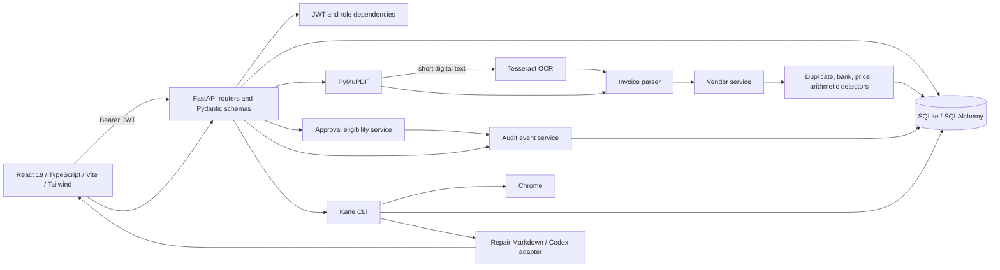

# LedgerLock Architecture

This note describes the current implementation; the root [README](../README.md) is the setup and judge entry point.

## Components

## Request and Persistence Boundaries

- `backend/main.py` registers routers and runs Phase 2, Phase 3, and Phase 5 schema creation/migrations before serving. SQLite lives at `backend/ledgerlock.db`.
- `backend/routes/invoices.py` validates PDF name, signature, and size; extracts/parses; resolves the vendor; stores the original PDF under `backend/storage/invoices/`; persists the invoice/items; and runs fraud analysis before commit. Invoice API schemas omit `raw_text`; the source route requires finance-role JWT.
- `backend/services/fraud_engine.py` aggregates findings, calculates a capped heuristic score, sets risk state, resets previous findings on reanalysis, and persists the new set.
- `backend/routes/approvals.py` is the authorization/transaction boundary for reviewer, verifier, approver, rejection, and per-invoice audit actions. `backend/services/approval_service.py` independently checks approval eligibility; front-end controls do not replace these checks.
- `backend/routes/audit.py` returns global read-only history; no audit update/delete routes are registered.
- `backend/routes/assurance.py` validates scenario prerequisites and retest links. `backend/services/kane_execution.py` launches `kane-cli`, parses Agent-mode NDJSON, stores outcomes, and only records evidence paths when an actual `.evidence` file exists.
- `scripts/repair_from_kane.py` consumes a persisted FAILED run. It generates an agent-neutral Markdown report and optionally invokes Codex CLI. Other agents are manual handoffs; see [agent workflow](AGENT_INTEGRATION.md).

## Risk Decision Semantics

The score sums severity weights (CRITICAL 100, HIGH 75, MEDIUM 35, LOW 10) and caps at 100; it is a heuristic, not a probability. Any HOLD action wins status aggregation; otherwise any finding produces REVIEW; no findings produces CLEAR. Extraction completeness is included in the finding set.

The supported bank exception requires exactly one finding and that finding must be `BANK_DETAILS_CHANGED`; the invoice must have completed independent verification by someone other than the approver. A duplicate or additional finding cannot use this exception. A REVIEW invoice must have reviewer clearance, no HOLD finding, a reviewer timestamp, and no new finding created after that clearance; the reviewer and approver must differ.

## Storage and Trust

- SQLite, uploaded PDFs, `.env`, generated PDFs, Kane evidence, and agent feedback are local runtime data and ignored by Git.
- Seed data is synthetic; it does not connect to a bank or initiate payments.
- Vendor bank details are established in the trusted vendor profile and are not overwritten from uploaded invoice fields.
- Migrations are idempotent additive scripts for the existing SQLite schema. They are not a general migration framework such as Alembic.

## Known Boundaries

The invoice listing endpoint returns at most 100 records; dashboard aggregates are based on that response. Fraud detectors use the current local invoice history, not a calibrated model. The frontend and backend were developed/tested on Linux; the browser smoke is performed by Kane CLI using local Chrome. Production deployment needs additional storage, secret-management, privacy, access-control, backup, concurrency, and operational hardening.
