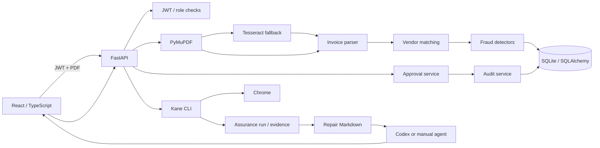

# Architecture

## Data flow

## Main implementation files

| Area | Files |
|---|---|
| App/router startup | `backend/main.py` |
| Auth and roles | `backend/core/` |
| API routes | `backend/routes/auth.py`, `invoices.py`, `approvals.py`, `audit.py`, `assurance.py` |
| Schemas | `backend/schemas/` |
| Database models | `backend/models/` |
| PDF extraction/OCR | `backend/services/pdf_extractor.py` |
| Invoice parsing | `backend/services/invoice_parser.py` |
| Vendor matching | `backend/services/vendor_service.py` |
| Fraud rules | `backend/services/duplicate_detector.py`, `bank_detector.py`, `price_detector.py`, `arithmetic_detector.py`, `fraud_engine.py` |
| Approval policy | `backend/services/approval_service.py` |
| Audit | `backend/services/audit_service.py` |
| Kane execution/parsing | `backend/services/kane_runner.py`, `kane_execution.py`, `kane_parser.py` |
| Agent handoff | `scripts/repair_from_kane.py` |
| Frontend | `frontend/src/pages/`, `frontend/src/components/`, `frontend/src/services/api.ts` |

## Request boundaries

- `POST /api/invoices/upload`: validate PDF extension/signature/size, extract text or OCR, parse fields/items, match vendor, run fraud analysis, persist invoice and PDF.
- `backend/services/fraud_engine.py`: aggregate findings, calculate capped heuristic score, set `CLEAR` / `REVIEW` / `HOLD`.
- `backend/routes/approvals.py` + `approval_service.py`: enforce reviewer, bank verification, approver, and rejection rules on the server.
- `backend/routes/audit.py`: read-only audit history.
- `backend/routes/assurance.py`: validate Kane scenario inputs and linked retest.
- `backend/services/kane_execution.py`: launch Kane, parse NDJSON, store result and only store evidence path when an actual `.evidence` file exists.

## Policy rules

- Any `HOLD` finding makes the invoice `HOLD`; otherwise findings mean `REVIEW`; no findings means `CLEAR`.
- A `REVIEW` invoice needs reviewer clearance; reviewer and approver must differ.
- Bank exception requires exactly one `BANK_DETAILS_CHANGED` finding and independent verification by someone other than the approver.
- Duplicate or mixed HOLD findings cannot use the bank exception.
- Approval checks are backend-enforced; blocked attempts are audited.
- Audit APIs have no update/delete routes.

## Runtime data

- SQLite: `backend/ledgerlock.db`
- Uploaded PDFs: `backend/storage/invoices/`
- Environment: `backend/.env`
- Generated Kane evidence and agent feedback: local runtime artifacts

These are local data and should not be committed. Demo seed records are synthetic.